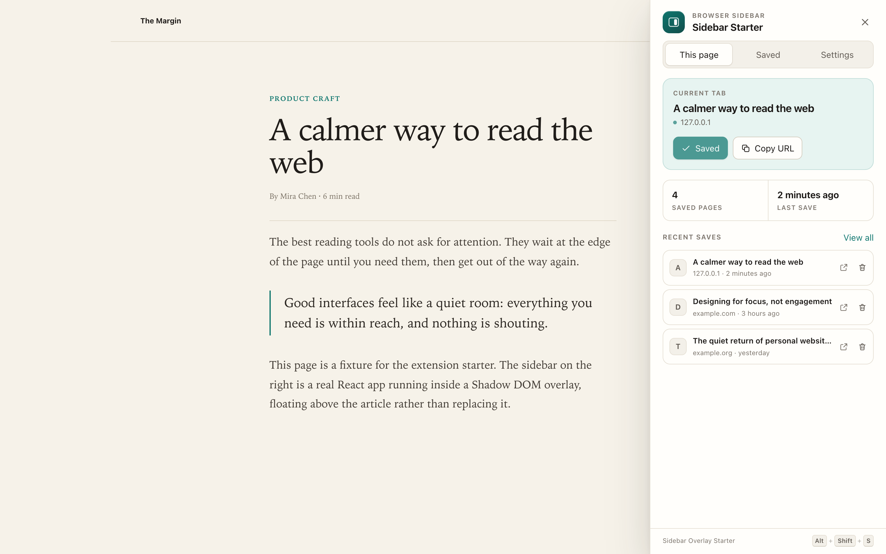

# Sidebar Overlay Starter

A Chrome, Edge, and Safari Manifest V3 starter for building a React sidebar that slides in over the current page. No popup, no separate side panel window: the UI is injected into a Shadow DOM overlay and floats above the page from the right edge.



## What is included

- React 19 + TypeScript + Vite
- Manifest V3 background service worker
- Content-script overlay isolated with Shadow DOM
- Open/close state shared through a small external store
- Saved-pages and settings persistence via `chrome.storage.local`
- Light, dark, and system themes; standard and wide panel widths
- Accessible tablist, keyboard navigation, focus states, and Escape-to-close
- A standalone UI preview with HMR for fast styling work
- A Safari temporary-install zip workflow that does not require Xcode
- Extension icons and a demo screenshot

The starter is intentionally small. The "Saved" tab is a working example of storage and list UI, not a finished product.

## Requirements

- Node.js 20.19+ (tested with Node 25)
- Chrome or Edge 102+
- Safari 17+ for local testing through a temporary extension

## Quick start

```bash
npm install
npm run build
```

Then load the extension:

1. Open `chrome://extensions` (or `edge://extensions`).
2. Enable **Developer mode**.
3. Choose **Load unpacked** and select the `dist` directory.

Open any normal web page and click the extension icon. In Chrome, Edge, and Safari, `Alt+Shift+S` also toggles the sidebar. Press Escape or click the close button to dismiss it.

## Safari

Safari cannot import `.crx` files. For local development, package the build as a zip and install it as a temporary extension. This does not require Xcode.

```bash
npm run safari
```

This builds the extension and writes:

```text
artifacts/sidebar-overlay-starter-0.1.0-safari.zip
```

Install it:

1. Open Safari > Settings > Advanced, then enable **Show features for web developers**.
2. Open the **Developer** tab and enable **Allow unsigned extensions**.
3. Choose **Add Temporary Extension…** and select the zip file, or select the `dist` folder directly for faster iteration.
4. Open the **Extensions** tab and enable the extension.
5. Reload any tabs that were already open, then click the extension's toolbar button.

Safari may ask for permission to access the current website. Allow it, or choose **Always Allow on Every Website**, so the content script can load the overlay.

Safari resets **Allow unsigned extensions** when it quits. Temporary extensions are also removed after 24 hours or when Safari quits.

Use `npm run safari:zip` to package the current `dist` directory without rebuilding. After a rebuild, remove the old temporary extension and add the new zip, or use Safari's reload control.

### If the toolbar button does nothing

1. Check that the extension is still enabled in Safari > Settings > Extensions. Safari removes temporary extensions when it quits, and resets **Allow unsigned extensions**.
2. Set website access to **Always Allow on Every Website** for this extension, then reload the page. Without host access the content script cannot load and the background script cannot inject it.
3. Drag the extension icon into Safari's toolbar if it is in the overflow menu. Safari has a known bug where clicking an extension in the overflow menu does not dispatch the toolbar action.
4. Open Safari's **Develop** menu and choose **Web Extension Background Content**. If the extension is missing or shows an error, remove the temporary extension and add the zip again.
5. As a fallback, press `Alt+Shift+S` on the page. The shortcut is handled by the content script, so it does not depend on Safari's background script.

On a failed click the extension sets a `!` badge and changes the toolbar title to an access hint. Open the current page after granting access and click again.

### Signed distribution

A permanent install or App Store release still requires full Xcode, an Apple Developer identity, and signing. Generate an Xcode project with Apple's packager:

```bash
xcrun safari-web-extension-packager dist \
  --project-location safari \
  --app-name "Sidebar Overlay Starter" \
  --bundle-identifier com.example.sidebaroverlay \
  --macos-only \
  --swift \
  --force \
  --no-open \
  --no-prompt
```

Open the generated project in Xcode, configure your team, then build and run the macOS app. Distribution outside the App Store also requires notarization. The packager was previously named `safari-web-extension-converter`. This repository does not automate signing or notarization.

## Development

There are two workflows.

### Build and reload the extension

```bash
npm run dev
```

This watches both Vite builds and writes to `dist` as you edit. After a rebuild, reload the extension on `chrome://extensions`, then refresh the page you are testing. Content scripts are not hot-reloaded inside an already loaded page.

### Style and build the UI in a normal browser tab

```bash
npm run dev:ui
```

This opens `preview.html` with Vite HMR. The page renders the same `<App />` component against `localStorage` instead of `chrome.storage.local`, so you can iterate on layout and styling without reloading the extension. The preview is not part of the extension bundle.

### Scripts

| Script | Purpose |
| --- | --- |
| `npm run dev` | Watch the background/public build and the content-script build |
| `npm run dev:ui` | Serve `preview.html` for UI work with HMR |
| `npm run build` | Clean `dist` and produce the loadable extension |
| `npm run safari` | Build and package `artifacts/*-safari.zip` for temporary Safari installs |
| `npm run safari:zip` | Package the current `dist` without rebuilding |
| `npm run typecheck` | Run TypeScript with no emit |
| `npm run clean` | Remove `dist` |

## Project structure

```text
public/
  manifest.json          Extension manifest (MV3)
  icons/                 Toolbar, extension, and store icons
src/
  background/index.ts    Toolbar click handler and content-script injection
  content/index.tsx      Creates the Shadow DOM host and mounts React
  content/App.tsx        Sidebar UI: Page, Saved, and Settings tabs
  content/store.ts       Tiny open/closed store used with useSyncExternalStore
  content/storage.ts     chrome.storage/localStorage persistence helpers
  content/styles.css     Scoped design system and panel animations
  content/icons.tsx      Inline SVG icons
  preview/               Standalone HMR preview for UI work
  shared/messages.ts     Message contract and overlay host ID
scripts/
  package-safari.mjs     Validates dist and creates the Safari temporary-install zip
vite.config.ts           Background and public-asset build
vite.content.config.ts   Content-script IIFE build
```

## How it works

1. A click on the toolbar action reaches `src/background/index.ts`.
2. The background script sends a `sidebar:toggle` message to the active tab.
3. If no content script is listening yet (for example, a tab that was open before the extension loaded), the background script injects `content.js` with `chrome.scripting.executeScript` and sends the message again.
4. The content script creates a single host element, attaches an open Shadow DOM, and renders `<App />` inside it.
5. Open state lives in `content/store.ts`; the UI reads it with `useSyncExternalStore`.
6. Saved pages and settings are written to `chrome.storage.local`, with a `localStorage` fallback for the preview page.

The panel is closed by default. It is rendered once per page and only translated off-screen when closed, so opening it again is instant.

The Safari zip contains the same `dist` build. Safari loads it as a temporary extension, so there is no separate Safari runtime build.

## Permissions

| Permission | Why it is needed |
| --- | --- |
| `storage` | Persist saved pages and UI settings locally |
| `scripting` | Inject the content script into tabs that were already open when the extension was installed or reloaded |
| `http://*/*`, `https://*/*` | Let the content script run and the panel appear on any normal site |

If your product only needs a few domains, narrow `host_permissions` and `content_scripts.matches` in `public/manifest.json`. Broad host access is the main store-review and trust cost of this approach.

The extension makes no network requests. Saved titles and URLs stay in local extension storage.

## Customizing

- **Branding:** update `name`, `short_name`, `description`, and `version` in `public/manifest.json`, plus the header text in `src/content/App.tsx`.
- **Icons:** replace the PNGs in `public/icons/`. Keep the sizes declared in the manifest. `icon.svg` is the editable source.
- **Colors, spacing, motion:** edit the custom properties at the top of `src/content/styles.css`. All selectors are scoped under `.sidebar-shell`.
- **Tabs and features:** start in `src/content/App.tsx`. The component is the whole product surface.
- **Storage schema:** adjust the types and keys in `src/content/storage.ts`, then update the manifest if you add permissions.
- **Shortcut:** edit the key check in the `keydown` listener in `src/content/index.tsx`. It is handled by the page content script so it works in Safari too. If you prefer a browser-level command, add `commands._execute_action` back to the manifest and remove the content-script listener, otherwise the shortcut toggles twice.
- **Panel width:** the `standard` and `wide` values are in `styles.css`; the labels are in `App.tsx`.

### Rebranding checklist

1. Rename the package in `package.json`.
2. Update the manifest name, description, and icons.
3. Rename the `HOST_ID` in `src/shared/messages.ts` if another extension on the same page might use the same host ID.
4. Replace the screenshot in `docs/`.
5. Update this README.

## Security and privacy notes

- The Shadow DOM root is **open**. Page scripts can read the panel's contents through it. If that matters for your product, change `attachShadow({ mode: 'open' })` in `src/content/index.tsx` to `mode: 'closed'`. Note that closed roots are harder to inspect in DevTools and cannot be pierced by Playwright locators.
- Styles are injected with a constructable stylesheet, with an inline `<style>` fallback. The host element uses `all: initial` plus explicit overrides so page CSS does not leak into the panel. This was smoke-tested against a page with a strict CSP.
- The content script reads only `document.title` and `window.location` for the current-tab card. Saved data never leaves the browser.
- Before publishing, review the broad host permissions, add a privacy policy, and audit any feature that reads page content.
- `window.confirm` is used for "Clear all". Replace it with an in-panel confirmation if your design system forbids native dialogs.

## Known limitations

- Safari support uses temporary extension installs for local testing. Safari removes them after 24 hours or when Safari quits, and rejects unsigned persistent installs. A signed distribution requires Xcode, an Apple Developer identity, and notarization or the App Store. Safari cannot import CRX files.
- Firefox is not configured. It needs a different background-script manifest and the `browser.*` namespace conventions.
- Browser-internal pages (`chrome://`, `edge://`, `about:`, `devtools://`, `view-source:`, `safari://`) and the Chrome Web Store cannot be scripted. The toolbar action does nothing there.
- Safari's `chrome.storage.local` quota is 5 MB by default.
- The content script is injected at `document_idle`; pages that replace `document.documentElement` after load may remove the host element.
- There is no build-time dev server inside the extension. Use `npm run dev:ui` for UI iteration and `npm run dev` plus a page refresh for integration testing.
- Saved pages are stored per browser profile. `chrome.storage.sync` can be swapped in if cross-device sync is wanted.

## License

Apache License 2.0. See [LICENSE](LICENSE).
